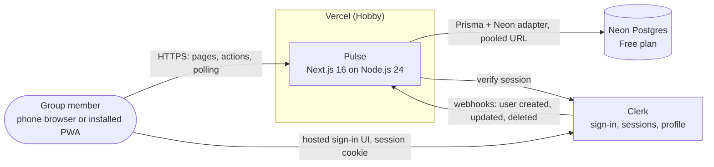
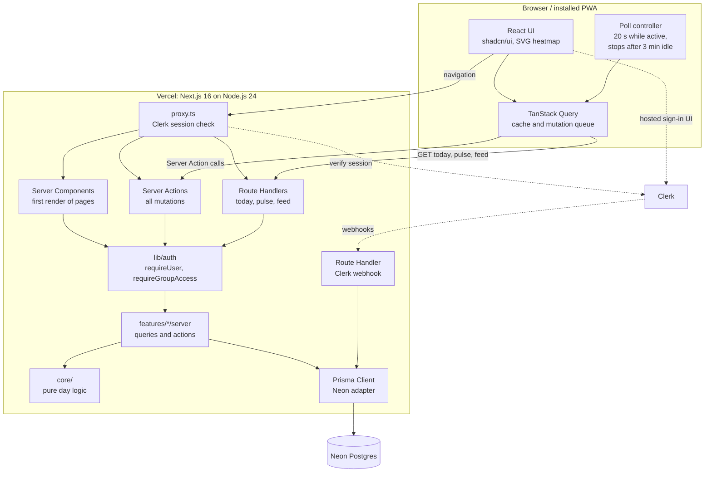
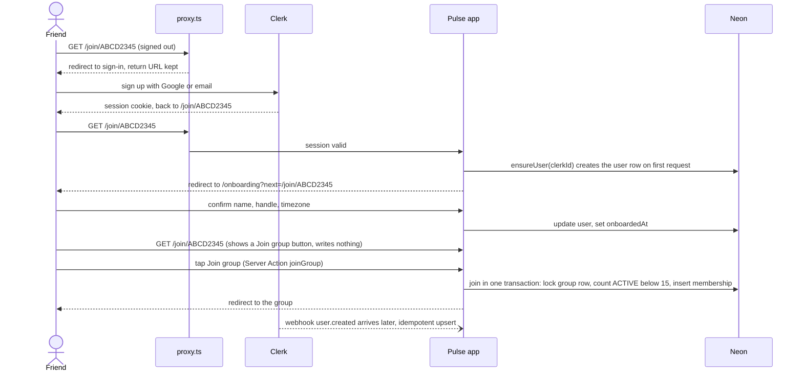
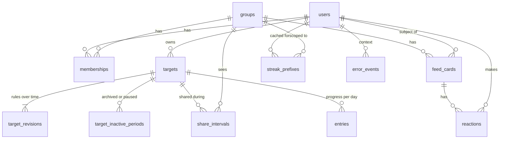

# Pulse — Technical Architecture Document (TAD)

| | |
|---|---|
| **Status** | Approved (rev 2) |
| **Date** | 2026-10-27 |
| **Revisions** | rev 1: initial approval. rev 2: refinements found while designing the schema and API (`docs/DB_SCHEMA.md` §9, `docs/API_SPEC.md` §8.1), the documented `btree_gist` fallback, a one-tap join button, and test-plan items TP-08 and TP-09. |
| **Inputs** | `docs/BRIEF.md`; `docs/PRD.md` (Approved rev 2), including the carry-forward notes in PRD §9.2 |
| **Companions** | `docs/DB_SCHEMA.md` (schema and data rules), `docs/API_SPEC.md` (every surface) |
| **Next documents** | Tasks + test plan |
| **Decision records** | `docs/adr/0001` … `0006` (index in §1.5) |

**Scope.** This document fixes the architecture: components, versions, algorithms, data flow, security and deployment. It does **not** contain the full Prisma schema or the endpoint contracts; those are in `docs/DB_SCHEMA.md` and `docs/API_SPEC.md`. Names of tables, routes and functions below are design handles that the schema/API documents may refine. Code blocks are TypeScript-flavoured pseudocode. `FR-`, `BR-`, `NFR-` IDs refer to the PRD.

---

## 0. Decisions (approved 2026-10-27)

You approved the items below on 2026-10-27. §0.5 records the changes you asked for at approval; the PRD was updated to **rev 2** to match.

### 0.1 Libraries outside the brief's stack: approved

| Package | Version | Why it is needed | Decision |
|---|---|---|---|
| `vitest` (dev) | 5.0.5 | NFR-QUAL-01 requires day logic to be verified in many timezones. That needs a test runner, and the brief names none. | **Approved.** Runs the pure `core/` tests under several `TZ` values. |
| `@prisma/adapter-neon` | 7.10.1 | Prisma 7 reaches Neon through a driver adapter. It brings `@neondatabase/serverless` 1.2.0 as its own dependency. | **Approved.** |
| shadcn/ui's component dependencies: `radix-ui` 1.8.1, `class-variance-authority` 0.7.1, `clsx` 2.1.1, `tailwind-merge` 3.7.0, `tw-animate-css` 1.4.0, `sonner` 2.0.8 | as listed | Pulled in by the shadcn components we use. `sonner` is shadcn's toast, needed for the visible save-failure message (FR-CHK-08). | **Approved.** |
| `server-only` | 0.0.1 | Makes the build fail if client code imports a server module, which protects NFR-SEC-02 (private targets never leak). | **Approved.** |

**Deliberately not added** (alternatives chosen inside the stack): `svix` (Clerk's own `verifyWebhook` covers it), `next-themes` (a ~30-line theme provider instead), Sentry or any error service (errors go to our own table, §9.4), Redis/Upstash (v1.1 rate limiting uses the database), `neverthrow` (hand-rolled `Result`), `ws` (Node 24 has a global WebSocket; confirmed in spike S1), Playwright, Testing Library and any property-testing library such as `fast-check` (TP-01 uses a hand-written seeded generator). Ask again when we plan E2E or component tests.

### 0.2 Version pins: approved

| Package | npm `latest` | Pinned | Reason |
|---|---|---|---|
| `typescript` | 7.0.2 | **6.0.3** | `typescript-eslint` 8.72.1 (pulled in by `eslint-config-next`) declares `typescript >=4.8.4 <6.1.0`. Revisit when it supports 7. |
| `prisma` (CLI) | **8.0.0-rc.27** (a release candidate) | **7.10.1** | `@prisma/client` and `@prisma/adapter-neon` are at 7.10.1. Never install `prisma@latest`; pin all three exactly. |
| `eslint` | 10.13.0 | **9.39.5** | `eslint-plugin-import` 2.32, `jsx-a11y` 6.10 and `react` 7.37 (all pulled in by `eslint-config-next`) do not declare ESLint 10 support. |
| Node.js | 26.12.1 (current, not LTS) | **24.x LTS** (24.22.1 on 2026-10-20) | LTS. Your local Node 22.23.2 also satisfies every engines range, but use 24 for parity with Vercel. `@types/node` pinned to 24.19.2. |

### 0.3 PRD amendments: applied in PRD rev 2

- **A. Heatmap keyboard model.** FR-HM-03, FR-HM-04 (first scenario), NFR-A11Y-02 and PRD §9.2 note 5 now describe a single keyboard stop with a text summary and a day-by-day list (design in §8). The list replaces the brief's "tooltip on keyboard focus".
- **B. Polling fallback ladder.** NFR-POLL-04 now allows shortening the idle stop and, as a last resort, removing background refreshing before the cadence is relaxed. With the 3-minute stop of §0.5 the numbers are: idle stop 3 minutes → 1 minute (L1), then no background refreshing (L2). Design in §12.4.

### 0.4 Interpretations and additions: approved

- **"v1.1 adds screens, not migrations."** For the four concerns you named (owner role, membership status, share intervals, target pause) the v1.0 schema already contains everything, so v1.1 needs **zero** migrations for them. Every other v1.1 feature needs **purely additive** migrations: new tables, nullable columns, enum values; never a rewrite or backfill (§14.2).
- **Additions the PRD did not spell out**, all within the stack: an `error_events` table (Vercel Hobby keeps runtime logs for only 1 hour, so NFR-OPS-01 needs our own record, §9.4); a derived `streak_prefixes` cache (keeps polling cheap, §6.4); a server-supplied polling hint (the lever for §12.4); and the v1.0 account-deletion safety net (§4.5), which delivers part of FR-ACC-07's visible effect early without erasure, owner succession or a delete-account screen.
- **Archive and pause share one table.** Both are stored as "inactive periods", so restore (FR-TGT-09) and pause (FR-PAU-*) need no migration.

### 0.5 Changes requested at approval

1. **Polling stops after 3 minutes without user interaction** (was 15). Consequences: the 60-second tier is removed, because it would now begin after the stop; hidden tabs never poll; polling resumes immediately on focus or interaction. PRD NFR-POLL-02 and NFR-POLL-04 are updated (rev 2). TAD §7.3, §12.3 and §12.4 are updated, including a realistic compute-hour estimate for 15 users making 2 visits a day of about 3 minutes each, plus Neon's 5-minute scale-to-zero tail.
2. **Cached streaks must equal a full recomputation**, including after unshare, timezone change and backfilled check-offs. Carried to the test plan as requirement **TP-01** (§16); the reference implementation and the invalidation rules are in §6.4.


---

## 1. System context and components

### 1.1 Context



### 1.2 Components



### 1.3 Architecture principles

1. **The server decides what day it is.** Devices never supply authoritative dates (BR-DAY-1, NFR-SEC-04). §5.
2. **Derive, do not generate.** Scheduled tasks, missed days, levels and streaks are computed from small, durable facts. No cron, no backfill. ADR-0003.
3. **Pure core, thin shell.** All day, schedule, level, streak and roll-call logic lives in `core/` as pure functions with an injected clock and no process-timezone dependence. They are unit-testable in isolation (NFR-QUAL-01) and reused by server and client.
4. **Authorization is enforced by types.** Group data cannot be read without a `GroupAccess` value that only the membership check can mint. §4.4.
5. **Polling must be cheap for the database.** The poll endpoint reads a small, bounded window and never scans history. §6.4, §7.2.
6. **The schema only grows.** Everything v1.1 needs for the four named concerns already exists in v1.0. §14.

### 1.4 Runtime model

- All server code runs on **Vercel's Node.js runtime** (not Edge): Prisma with the Neon adapter needs it, and the database stays one hop away. Function region = Neon region (§12.1).
- **Rendering:** every authenticated page is dynamic. No ISR and no `use cache` on user data in v1.0.
- **Client JavaScript** is limited to interactive islands: checklist, heatmap tooltips, poll controller, reactions, forms.
- **Mutations** are Server Actions. **Reads from the client** are three Route Handlers (`today`, `pulse`, `feed`). The Clerk **webhook** is a fourth. Full contracts belong to the API spec.
- **No service worker in v1.0.** The offline screen (FR-PWA-04) is v1.1, and web.dev's install criteria list no service-worker requirement (§8.5, spike S4).

### 1.5 Architecture decision records

| ADR | Decision |
|---|---|
| [0001](adr/0001-neon-postgres-with-prisma.md) | Neon Postgres with Prisma 7 and the Neon driver adapter |
| [0002](adr/0002-clerk-auth-with-webhook-sync.md) | Clerk for authentication, with lazy user creation plus webhook sync |
| [0003](adr/0003-derive-scheduled-days-on-read.md) | Derive scheduled days on read instead of generating task rows |
| [0004](adr/0004-polling-instead-of-realtime.md) | Polling through one consolidated endpoint instead of realtime |
| [0005](adr/0005-store-local-calendar-dates.md) | Store local calendar dates, not timestamps, for day logic |
| [0006](adr/0006-personal-targets-shared-via-share-intervals.md) | Personal targets shared to groups through share intervals |

---

## 2. Tech stack and exact versions

Verified with `npm view` on 2026-10-27, including `dist-tags`, `peerDependencies` and `engines`. All versions are pinned exactly (`save-exact=true` in `.npmrc`, lockfile committed, `engines.node` set to `>=24 <25`).

| Layer | Package | Version | Notes |
|---|---|---|---|
| Runtime | Node.js | 24.x LTS (24.22.1) | Next ≥20.9, Prisma `^20.19 \|\| ^22.12 \|\| >=24`, Vitest `^22.12 \|\| ^24 \|\| >=26`: all satisfied. |
| Framework | `next` | 16.4.3 | App Router, Server Components, Server Actions. `middleware` is now `proxy.ts`. |
| | `react`, `react-dom` | 19.3.1 | Peer range of `@clerk/nextjs` 7.9.21 allows `~19.3.0`. |
| Language | `typescript` | 6.0.3 | Strict mode. See §0.2 (not 7.0.2). |
| Styling | `tailwindcss`, `@tailwindcss/postcss` | 4.3.3 | CSS-first configuration. |
| UI kit | `shadcn` (CLI, not a runtime dependency) | 4.23.0 | Copies components into `src/components/ui`. |
| | `lucide-react` | 1.62.0 | Icons. |
| | `framer-motion` | 14.7.1 | Used sparingly. The same release also ships as `motion`; we import from `framer-motion` as the brief says. |
| Database | `prisma` (dev), `@prisma/client` | 7.10.1 | Pin all three Prisma packages to the same version. |
| | `@prisma/adapter-neon` | 7.10.1 | Brings `@neondatabase/serverless` 1.2.0. §0.1. |
| Auth | `@clerk/nextjs` | 7.9.21 | Peer: `next ^16.0.10`. Includes `verifyWebhook` (`@clerk/nextjs/webhooks`). |
| Data fetching | `@tanstack/react-query` | 5.105.0 | Mutation scopes, optimistic updates, polling. |
| Validation | `zod` | 4.6.7 | |
| Dates | `date-fns` | 4.4.0 | Presentation only. See §5.8. |
| | `date-fns-tz` | 3.2.0 | Peer: `date-fns ^3 \|\| ^4`. Instant → zone conversion only. |
| Testing (dev) | `vitest` | 5.0.5 | §0.1. |
| Tooling (dev) | `eslint` 9.39.5, `eslint-config-next` 16.4.3 | | `typescript-eslint` 8.72.1 arrives transitively. |
| Types (dev) | `@types/node` 24.19.2, `@types/react` 19.3.0, `@types/react-dom` 19.3.0 | | |
| shadcn deps | `radix-ui` 1.8.1, `class-variance-authority` 0.7.1, `clsx` 2.1.1, `tailwind-merge` 3.7.0, `tw-animate-css` 1.4.0, `sonner` 2.0.8 | | §0.1. |
| Server guard | `server-only` | 0.0.1 | §0.1. |

---

## 3. Folder structure (feature-based)

```
pulse/
├─ prisma/
│  ├─ schema.prisma
│  ├─ migrations/              # SQL; hand-edited where Prisma cannot express a constraint (§14.3)
│  └─ seed.ts                  # dev data: a group, members in several timezones
├─ prisma.config.ts            # CLI datasource = DIRECT_URL
├─ public/icons/               # 192, 512, 512-maskable, apple-touch 180
├─ src/
│  ├─ proxy.ts                 # Clerk session check (Next 16 name for middleware)
│  ├─ app/                     # routing and composition only; no business logic
│  │  ├─ layout.tsx · globals.css · manifest.ts · apple-icon.png
│  │  ├─ (public)/sign-in/[[...sign-in]]/page.tsx · sign-up/[[...sign-up]]/page.tsx
│  │  ├─ (app)/
│  │  │  ├─ layout.tsx         # requireUser(), onboarding redirect, navigation shell
│  │  │  ├─ onboarding/page.tsx
│  │  │  ├─ today/page.tsx
│  │  │  ├─ targets/ (page.tsx · new/page.tsx · [targetId]/page.tsx)
│  │  │  ├─ groups/new/page.tsx   # create-group form and a "join with a code" form
│  │  │  ├─ groups/[groupId]/ (page.tsx · members/page.tsx)
│  │  │  ├─ join/[code]/page.tsx   # shows a Join group button; never writes on GET
│  │  │  └─ settings/profile/page.tsx
│  │  └─ api/
│  │     ├─ today/route.ts
│  │     ├─ groups/[groupId]/pulse/route.ts
│  │     ├─ groups/[groupId]/feed/route.ts
│  │     └─ webhooks/clerk/route.ts
│  ├─ features/
│  │  ├─ accounts/  groups/  targets/  sharing/  checklist/
│  │  ├─ heatmap/   rollcall/  feed/   reactions/  pwa/
│  │  │    each feature:
│  │  │      components/          # client and server UI
│  │  │      server/              # queries.ts · actions.ts · repo.ts   (imports 'server-only')
│  │  │      schema.ts            # Zod schemas and inferred types
│  │  │      index.ts             # the feature's public surface
│  ├─ core/                       # pure; no I/O, no Next, no Prisma, no process timezone
│  │  ├─ time/      local-date.ts · zone.ts · effective-today.ts · iso-week.ts
│  │  ├─ schedule/  revision.ts · is-scheduled.ts · share-interval.ts · day-state.ts
│  │  ├─ level.ts · streak.ts · rollcall.ts · invite-code.ts · limits.ts · templates.ts
│  ├─ lib/
│  │  ├─ db.ts · env.ts · result.ts · errors.ts · clock.ts · log-error.ts · primitives.ts
│  │  ├─ auth/ require-user.ts · ensure-user.ts · group-access.ts
│  │  └─ query-client.tsx · theme.tsx
│  └─ components/ui/              # shadcn output
├─ tests/ (core/ · features/ · fixtures/)
└─ docs/
```

**Dependency rules** (enforced by ESLint `no-restricted-imports`; a violation fails CI):

1. `app/` imports only from `features/*/index.ts`, `lib/`, `components/ui/`.
2. A feature never imports another feature's internals. Cross-feature use goes through `index.ts`. Allowed direction: `checklist`, `heatmap`, `rollcall`, `feed`, `groups` → `sharing`, `targets`; nothing imports `checklist`.
3. `core/` imports nothing outside `core/`, except `date-fns-tz` inside `core/time/zone.ts`.
4. The Prisma client (`lib/db.ts`) is imported only from `features/*/server/*`, `lib/auth/*` and the webhook handler.
5. Every file under `server/` and `lib/auth/` starts with `import 'server-only'`. Client components never import from `server/`.

---

## 4. Authentication and authorization

### 4.1 Provider, routes and protection

Clerk handles Google OAuth and email/password, hosted sign-in UI and sessions. Our database holds the application profile.

| Route | Access |
|---|---|
| `/sign-in`, `/sign-up`, `/manifest.webmanifest`, `/icons/*`, `/apple-icon*`, `/favicon.ico` | public (browsers fetch the manifest without credentials, so a protected manifest would break installability, FR-PWA-01) |
| `/api/webhooks/clerk` | public, **signature-verified** |
| everything else (pages, actions, `/api/*`) | `proxy.ts` calls `auth.protect()`; unauthenticated users are redirected to sign-in with the return URL kept |

`proxy.ts` is an **optimistic** check only (Next's own guidance says a proxy is not a full authorization layer). Every server entry point re-verifies identity and membership itself (§4.4).

Clerk's quickstart confirms: `proxy.ts` for Next.js 16+, `clerkMiddleware()` from `@clerk/nextjs/server`, `await auth()` in server code, and `/api/webhooks(.*)` must not be protected.

### 4.2 First sign-in through an invite link (FR-ACC-01/02/03, FR-GRP-03)



`(app)/layout.tsx` calls `requireUser()`. If `onboardedAt` is null and the path is not `/onboarding`, it redirects to `/onboarding?next=<path>`. This is how an invite survives sign-up and the profile step. `next` is validated as a same-site path (no `//host`, no absolute URL, not under `/api`) before it is used.

**The invite page never writes, and nobody joins without a user action.** After sign-in and onboarding the visitor lands on `/join/<code>`, which shows a one-tap **Join group** button. The button submits the `joinGroup` Server Action (API `A-04`), a POST. Prefetching or a link-preview bot therefore cannot join anyone.

### 4.3 User sync: lazy creation plus webhook (ADR-0002)

**Why both.** The webhook alone races the first request (FR-ACC-02 needs the profile to exist immediately). Lazy creation alone never learns about profile changes or deletions. Clerk's documentation also states webhooks are eventually consistent, can arrive out of order or twice, and are retried on 4xx/5xx or no response.

```ts
// lib/auth/ensure-user.ts  (the authoritative creation path; hot path = 1 query)
export async function ensureUser(clerkId: string): Promise<User | null> {
  const existing = await db.user.findUnique({ where: { clerkId } })
  if (existing) return existing.deletedAt ? null : existing      // tombstoned users cannot act
  const cu = await clerk().users.getUser(clerkId)                // only on a member's very first request
  return upsertFromClerk(cu)   // INSERT … ON CONFLICT (clerk_id) DO NOTHING, then re-read; handle suggested, retried on collision
}
```

```ts
// app/api/webhooks/clerk/route.ts
export async function POST(req: Request) {
  const evt = await verifyWebhook(req)                 // @clerk/nextjs/webhooks; bad signature → 400
  switch (evt.type) {
    case 'user.created':
    case 'user.updated': await applyProfile(evt.data); break  // ignored if the row is tombstoned
    case 'user.deleted': await tombstoneUser(evt.data.id); break
    default: break                                      // unsubscribed or unknown events → 200
  }
  return new Response(null, { status: 200 })            // any DB failure throws → 500 → Clerk retries
}
```

Only `user.created`, `user.updated` and `user.deleted` are subscribed in the Clerk dashboard. All handlers are idempotent. `applyProfile` copies the **display name** (`first_name` and `last_name`, else `username`, else "New member") and the **image URL** into our table, and never overwrites the member's handle (the handle is seeded only when `ensureUser` creates the row); **no read path ever calls Clerk for another member**, which is the foundation of NFR-REL-02.

### 4.4 Authorization helpers (FR-GRP-11, NFR-SEC-01)

```ts
// lib/auth/require-user.ts
export async function requireUser(): Promise<Result<User, AppError>> {
  const { userId } = await auth()
  if (!userId) return err(E.unauthenticated())
  const user = await ensureUser(userId)
  return user ? ok(user) : err(E.unauthenticated())          // tombstoned → treated as signed out
}

// lib/auth/group-access.ts
declare const brand: unique symbol
export type GroupAccess = { readonly [brand]: 'GroupAccess'; groupId: string; userId: string; role: 'OWNER' | 'MEMBER' }

export async function requireGroupAccess(
  groupId: string, opts: { role?: 'OWNER' } = {},
): Promise<Result<GroupAccess, AppError>> {
  const u = await requireUser(); if (!u.ok) return u
  const m = await db.membership.findFirst({
    where: { userId: u.value.id, groupId, status: 'ACTIVE', group: { deletedAt: null } },
    select: { role: true },
  })
  if (!m) return err(E.notFound())                // never FORBIDDEN: do not reveal that the group exists
  if (opts.role === 'OWNER' && m.role !== 'OWNER') return err(E.forbidden())   // they already know it exists
  return ok(mint({ groupId, userId: u.value.id, role: m.role }))               // `mint` is not exported
}

// lib/auth/target-access.ts (same idea for target-scoped writes)
export async function requireTargetOwner(targetId: string): Promise<Result<{ user: User; target: Target }, AppError>> { /* ownerId === user.id, else NOT_FOUND */ }
```

**Enforcement by types.** Every function in `features/*/server/queries.ts` that reads group data takes `access: GroupAccess` as its first parameter. `GroupAccess` cannot be constructed outside `lib/auth`, so a group query without the membership check does not compile. The same applies to `TargetAccess` for target writes.

### 4.5 A user deleted in the provider must never break group pages (NFR-REL-02)

FR-ACC-07 (full deletion) is v1.1. v1.0 does only the minimum that guarantees nothing breaks. On `user.deleted`, `tombstoneUser` runs in **one transaction**:

1. `users`: set `deleted_at`, display name → "Former member", `image_url` → null, handle → `deleted_` plus the first 12 hex digits of the id (frees the handle). **The row is kept** with its `clerk_id`, so a late `user.updated` cannot recreate it.
2. Their `memberships`: status → `REMOVED`, `ended_at` set. Because every group query already filters `status = 'ACTIVE'`, they vanish from roll call, comparison rows and feed exactly as BR-SHARE-5 describes for removal. **No new special cases in any read path.**
3. Close all open `share_intervals` of their targets at their effective yesterday, or delete those that began today (`from_date` after that day), because `from_date <= to_date` must hold.
4. Delete their `streak_prefixes`.
5. **Nothing else is deleted.** Targets, entries, cards and reactions stay, so no foreign key can dangle.

| Situation | Behaviour |
|---|---|
| Deleted user was a plain member | Disappears from all group views. Their slot is freed for the 15-member cap. |
| Deleted user was the **owner** | Their membership becomes `REMOVED` (role stays `OWNER`). The group has **no active owner**. Every member page works; owner-only controls are simply absent for everyone. Joining and the invite keep working. Succession (BR-OWN-3) arrives with FR-ACC-07 in v1.1. |
| Webhook delayed | They cannot sign in anyway (Clerk rejects the session; `requireUser` also rejects tombstones). Others still see them until the webhook lands. No errors. |
| Webhook lost | Same as above, indefinitely. Harmless: pages never call Clerk for other members. A v1.1 reconciliation can add a sweep. |
| Duplicate or reordered events | `tombstoneUser` is idempotent; updates for tombstoned rows are ignored. |
| Avatar is null | UI renders initials; no component may assume `imageUrl` is non-null. |

**Tests (mandatory, part of the v1.0 definition of done):** fixtures with a deleted member and a deleted owner must render the group page, roll call, comparison view, feed, reactions and member list without error, and must never show the deleted member.

---

## 5. Date and timezone strategy

### 5.1 Principles (ADR-0005)

- **Day logic uses calendar dates, never timestamps.** A progress entry belongs to a `LocalDate` fixed when it is written; it is never recomputed from a timestamp (BR-DAY-4).
- **The server clock is the only source of "now"** (BR-DAY-1). The clock is injected (`lib/clock.ts`) so tests control it.
- **Clients send intent, not dates.** The check-off action sends `day: 'today' | 'yesterday'` plus the date the screen believed it was showing (`expectedDate`). The server resolves the day itself and rejects a mismatch (`STALE_DAY`). This detects a phone left open across midnight without trusting the device.

### 5.2 Types

```ts
type LocalDate = string & { readonly __brand: 'LocalDate' }   // 'YYYY-MM-DD', validated by Zod (z.iso.date())
type Zone = string & { readonly __brand: 'Zone' }             // IANA name, validated with Intl
```

- Postgres stores `DATE`. Prisma returns a JS `Date` at UTC midnight; **only the repository layer converts** (`toLocalDate(d) = d.toISOString().slice(0,10)`; `fromLocalDate(s) = new Date(s + 'T00:00:00Z')`).
- Comparison is lexicographic. Arithmetic (`addDays`, `weekdayISO`, `isoWeekStart`, `diffDays`) is implemented in `core/time/local-date.ts` with `Date.UTC`/`getUTC*` only.

### 5.3 Core functions

| Function | Purpose |
|---|---|
| `calendarDateIn(zone, now): LocalDate` | `formatInTimeZone(now, zone, 'yyyy-MM-dd')` (date-fns-tz) |
| `clockTimeIn(zone, now): 'HH:mm'` | `formatInTimeZone(now, zone, 'HH:mm')` |
| `effectiveToday(member, now): LocalDate` | the member's "today" including the BR-DAY-5 floor (§5.4) |
| `resolveDay(member, now, day): LocalDate` | `today` or `today − 1` |
| `isoWeekStart(d): LocalDate` | Monday of d's week |
| `afterCutoff(member, now): boolean` | BR-ROLL, 18:00 (§5.6) |

### 5.4 BR-DAY-5: the date never moves backwards

Persisted state: `users.timezone` and `users.date_floor` (nullable `DATE`).

```ts
const effectiveToday = (m: { zone: Zone; dateFloor: LocalDate | null }, now: Date): LocalDate => {
  const cal = calendarDateIn(m.zone, now)
  return m.dateFloor && m.dateFloor > cal ? m.dateFloor : cal          // the floor only matters while the new zone is behind
}

// the timezone-change step of updateProfile (API A-02): one transaction
const floor = effectiveToday(user, now)          // the date they were on, in the OLD zone
await db.user.update({ where: { id }, data: { timezone: newZone, dateFloor: floor } })
await db.streakPrefix.deleteMany({ where: { userId: id } })                // cheap, rebuilt lazily
```

No per-request writes: the floor is written only when the timezone changes, and it becomes irrelevant by itself once the new zone's calendar date reaches it.

**Worked example.** Priya is in Asia/Kolkata at 00:30 on 2026-10-28 (= 19:00 UTC on Oct 27). Her effective today is **Oct 28**. She switches to America/Los_Angeles (UTC−7 in late October 2026), where the calendar date is Oct 27. Floor = Oct 28.

| UTC instant | LA calendar date | Effective today | Note |
|---|---|---|---|
| Oct 27 19:00 | Oct 27 | **Oct 28** (held by floor) | change happens; her day does not go backwards |
| Oct 28 07:00 | Oct 28 | Oct 28 | LA reaches the floor; hold ends by itself |
| Oct 29 07:00 | Oct 29 | Oct 29 | normal from here |

Moving **forward** (e.g. London → Auckland) simply makes the calendar date larger; the floor is ignored. A forward jump of more than a day can leave a skipped date outside the edit window; that is accepted and is the same trade-off the PRD makes for BR-DAY-3.

### 5.5 Resolving a write

```ts
const date = resolveDay(user, clock.now(), input.day)
if (date !== input.expectedDate) return err(E.staleDay())   // client refetches Today and retries
```

### 5.6 Roll call across timezones (FR-ROL-01/02/03)

Each member is judged on **their own** effective today and local clock time. Because members' todays differ by at most one day for any realistic group, one bounded query serves everyone.

```ts
async function computeRollCall(access: GroupAccess, now: Date) {
  const members = await activeMembersWithZones(access)                        // ≤ 15 rows
  const todays = members.map(m => ({ m, today: effectiveToday(m, now) }))
  const lo = addDays(min(todays.map(t => t.today)), -1)                       // yesterday of the earliest-today
  const hi = max(todays.map(t => t.today))                                    // today of the latest-today
  const structure = await sharedStructure(access, [lo, hi])                   // targets + revisions + inactive periods + intervals
  const entries   = await entriesFor(structure.targetIds, [lo, hi])           // ≤ ~150 targets × ≤ 4 dates
  return todays.map(({ m, today }) => classify(m, today, structure, entries, now))   // pure, core/rollcall.ts
}

// core/rollcall.ts
function classify(m, today, s, e, now): RollCallState {
  const tracked   = s.trackedOn(m.id, today)                  // shared with this group and started, not archived
  if (tracked.length === 0) return 'NO_TARGETS_SHARED'
  const scheduled = tracked.filter(t => isScheduled(t, today))
  if (scheduled.length === 0) return 'REST_DAY'
  if (scheduled.some(t => (e.value(t.id, today) ?? 0) > 0)) return 'ACTIVE'      // BR-PRG-5: any progress
  return afterCutoff(m, now) ? 'SLACKING' : 'NOT_YET'
}

// cutoff only counts when the member's clock date equals their effective today (not during a BR-DAY-5 hold)
const afterCutoff = (m, now) =>
  calendarDateIn(m.zone, now) === effectiveToday(m, now) && clockTimeIn(m.zone, now) >= '18:00'
```

During a BR-DAY-5 hold the member's clock date is behind their effective today, so `afterCutoff` is false and they show **Not yet**, never Slacking.

### 5.7 Weeks and heatmap range

Weeks start Monday (BR-DAY-2). A heatmap's right edge is the **viewer's** effective today; its last column is `isoWeekStart(today)` and its first column is 51 weeks earlier (13 or 8 for narrow screens; the server always sends 52 weeks and the client slices). Cells after a **member's own** effective today are `FUTURE` (blank), which handles members whose date is behind the viewer's (FR-HM-05).

### 5.8 Independence from the process timezone

Vercel runs in UTC; a developer machine may not. The rule: **no function that depends on the process timezone may be used in domain logic.** `date-fns` is used only for presentation (formatting a `LocalDate` for display); all domain arithmetic is the UTC-only code in `core/time`.

NFR-QUAL-01 test matrix (Vitest, run under several `TZ` values with a fake clock):
`Pacific/Kiritimati` (+14), `Etc/GMT+12` (−12), `Asia/Kolkata` (+5:30), `Australia/Lord_Howe` (30-minute DST), `America/New_York` (DST start/end days), `Pacific/Apia` (a skipped day in 2011), `Africa/Casablanca` (DST suspended for Ramadan), plus timezone changes forward and backward mid-day, week boundaries, the edit window at local midnight, and the PRD's worked streak and level examples.

---

## 6. Algorithms

### 6.0 Entities used below (full model in §14)

`users(timezone, date_floor)` · `groups` · `memberships(role, status)` · `targets(owner, mode, start_date)` · `target_revisions(effective_from, goal, frequency, weekdays)` · `target_inactive_periods(kind: ARCHIVED|PAUSED, from_date, to_date?)` · `share_intervals(target, group, from_date, to_date?)` · `entries(target, local_date, value)` · `feed_cards(group, user, local_date, kind, last_activity_at)` · `reactions` · `streak_prefixes(user, group, through_date, run)`.

### 6.1 Deriving scheduled days on read (FR-TGT-03, FR-CHK-07, BR-SCH; ADR-0003)

```ts
// A rule is "the revision in force on that date".
const revisionOn = (revs: Revision[] /* sorted by effectiveFrom */, d: LocalDate) =>
  lastWhere(revs, r => r.effectiveFrom <= d)                      // binary search; undefined before the first

const inactiveKindOn = (periods: InactivePeriod[], d: LocalDate) => {
  const kinds = periods.filter(p => p.fromDate <= d && (p.toDate === null || d <= p.toDate)).map(p => p.kind)
  return kinds.includes('ARCHIVED') ? 'ARCHIVED' : kinds.includes('PAUSED') ? 'PAUSED' : undefined   // ARCHIVED wins when both cover the date
}

// Tracked = counts toward "something exists on this day". Archived days are NOT tracked; paused days ARE tracked.
const isTracked = (t: Target, periods, d) => d >= t.startDate && inactiveKindOn(periods, d) !== 'ARCHIVED'

const isScheduled = (t: Target, revs, periods, d): boolean => {
  if (!isTracked(t, periods, d)) return false
  if (inactiveKindOn(periods, d) === 'PAUSED') return false         // v1.1: nothing in v1.0 creates PAUSED rows
  const r = revisionOn(revs, d); if (!r) return false
  switch (r.frequency) {
    case 'DAILY': return true
    case 'SPECIFIC_DAYS': return r.weekdays.includes(weekdayISO(d)) // 1 = Monday … 7 = Sunday
  }                                                                  // v1.1 adds WEEKLY_QUOTA here without touching callers
}

const goalOn = (t, revs, d) => revisionOn(revs, d)?.goal ?? 1       // CHECKBOX behaves as goal 1
const isComplete = (t, revs, entries, d) => (entries.get(t.id, d) ?? 0) >= goalOn(t, revs, d)
```

- **Edits** (FR-TGT-06): with history, insert a revision with `effectiveFrom = today + 1` (replace one that already has that date). With no progress and `startDate ≥ today`, update the single revision in place. Mode is immutable once any entry exists.
- **Archive** (FR-TGT-07): insert `ARCHIVED` period `from = today + 1`, `to = null`. **Restore** (v1.1) closes it and the gap stays untracked. **Pause** (v1.1) inserts `PAUSED` periods.
- **Cost:** O(targets × days). A member with 10 targets over 364 days is ~3,640 checks; a 15-member group is ~55,000: single-digit milliseconds. `has history` (FR-TGT-08) = any entry exists or a scheduled day before today exists.

### 6.2 Share intervals and "unshare takes effect next day" (FR-VIS-01…06, BR-SHARE)

An interval `[from_date, to_date]` is **inclusive**; `to_date = null` means open.

```ts
const isSharedOn = (intervals: Interval[], d: LocalDate) =>
  intervals.some(i => i.fromDate <= d && (i.toDate === null || d <= i.toDate))

// today = the OWNER's effective today
async function share(tx, targetId, groupId, today) {           // BR-SHARE-2: counts from today, never retroactive
  const last = await latestInterval(tx, targetId, groupId)
  if (last && last.toDate === null) return                       // already open
  if (last && last.toDate === today) return reopen(tx, last)     // unshared and re-shared the same day → one interval again
  await insert(tx, { targetId, groupId, fromDate: today, toDate: null })
}

async function unshare(tx, targetId, groupId, today) {          // BR-SHARE-3: counts through today, stops tomorrow
  await closeOpen(tx, targetId, groupId, /* toDate */ today)     // past days stay in the group's history
}

async function onMemberRemoved(tx, userId, groupId, theirToday) { // BR-SHARE-5: immediate, history kept
  const closeAt = addDays(theirToday, -1)
  await deleteOpenBeginningAfter(tx, { ownerId: userId, groupId }, closeAt)   // began today: it never counted, and from_date <= to_date must hold
  await closeAllOpen(tx, { ownerId: userId, groupId }, /* toDate */ closeAt)
  await tx.streakPrefix.deleteMany({ where: { userId, groupId } })
}
```

Rejoin (BR-SHARE-6) changes only `memberships.status` back to `ACTIVE` and clears the prefix cache; **no interval is reopened**, so the member re-shares what they want and the absence days are untracked automatically.

**Newly shared groups get today's card.** When `setShares` adds a group it also runs `syncFeedCards` for today (§6.6), so a target that already has progress today shows on that group's card immediately. Cards of groups the target was removed from are not touched (FR-VIS-05).

Constraints that Prisma cannot express are added as SQL in the migration (§14.3): at most one open interval per (target, group), and no overlapping intervals.

### 6.3 Day state and heatmap level (FR-HM-02, BR-LEVEL)

```ts
type DayState = 'L0'|'L1'|'L2'|'L3'|'L4' | 'REST' | 'UNTRACKED' | 'TODAY_PENDING' | 'FUTURE'

function dayState(scope: Scope, d: LocalDate, memberToday: LocalDate): { state: DayState; done: number; scheduled: number } {
  if (d > memberToday) return { state: 'FUTURE', done: 0, scheduled: 0 }
  const visible   = targetsVisibleIn(scope, d)       // personal: all the member's targets · group: only those shared on d
  const tracked   = visible.filter(t => isTracked(t, d))
  if (tracked.length === 0) return { state: 'UNTRACKED', done: 0, scheduled: 0 }
  const scheduled = tracked.filter(t => isScheduled(t, d))
  if (scheduled.length === 0) return { state: 'REST', done: 0, scheduled: 0 }
  const done = scheduled.filter(t => isComplete(t, d)).length
  if (d === memberToday && done === 0) return { state: 'TODAY_PENDING', done, scheduled: scheduled.length }
  return { state: level(done, scheduled.length), done, scheduled: scheduled.length }
}

// Exact thresholds with integer arithmetic only (no floating point): 25 → L1, 33.3 → L2, 75 → L3, 80 → L4
function level(done: number, scheduled: number): 'L0'|'L1'|'L2'|'L3'|'L4' {
  if (done === 0) return 'L0'
  if (done * 4 <= scheduled) return 'L1'          // 0 < p ≤ 25
  if (done * 2 <= scheduled) return 'L2'          // 25 < p ≤ 50
  if (done * 4 <= scheduled * 3) return 'L3'      // 50 < p ≤ 75
  return 'L4'                                     // 75 < p ≤ 100
}
```

Today with progress shows its level plus a "today" marker (a presentation flag, not a state). Because personal and group scope use the **same** function with a different `visible` set, NFR-QUAL-02 (same member-day, same result everywhere) holds by construction.

### 6.4 Streaks: personal vs group, with bridging (FR-STK-*, BR-STREAK, FR-VIS-07)

The fold is one pure function; scope only changes which targets are visible.

```ts
type StreakDay = 'ACTIVE' | 'MISSED' | 'REST' | 'UNTRACKED' | 'TODAY_PENDING'
function toStreakDay(s: DayState): StreakDay | null {
  switch (s) {
    case 'FUTURE': return null
    case 'REST': return 'REST'
    case 'UNTRACKED': return 'UNTRACKED'
    case 'TODAY_PENDING': return 'TODAY_PENDING'
    case 'L0': return 'MISSED'        // tracked, at least one scheduled task, none complete, day is over
    default: return 'ACTIVE'          // L1–L4: at least one scheduled task complete
  }
}

// Advance a run by a sequence of days. REST and UNTRACKED bridge; TODAY_PENDING neither adds nor breaks.
function fold(run: number, days: StreakDay[]): number {
  for (const d of days) {
    if (d === 'ACTIVE') run += 1
    else if (d === 'MISSED') run = 0
  }
  return run                                        // a streak can only start on an ACTIVE day because run stays 0 otherwise
}
```

Check against the PRD example: Mon A, Tue A, Wed Rest, Thu A, Fri Missed, Sat A, Sun(today) A → runs 1, 2, 2, 3, **0**, 1, **2** → current streak 2 ✓. (Longest, v1.1: track `max(run)` in the same fold.)

**Personal streak** (Today page, FR-CHK-11): fold over the member's whole history. At most ~3.6k entries per year; it runs once per Today load, never in polling.

**Group streak** (polled): a full-history scan per poll would read ~16,000 entry rows per group-year, which would break the Neon transfer budget (§12.3). Instead use the **closed-days prefix**:

- Everything dated **before yesterday** is immutable: the edit window is only today and yesterday (BR-DAY-3), sharing starts today, unsharing and archiving take effect tomorrow, and rule edits apply from tomorrow. So the fold of those days never changes.
- Cache that fold in `streak_prefixes(user_id, group_id, through_date, run, algo_version)`.

```ts
async function groupStreak(access: GroupAccess, m: Member, now: Date): Promise<number> {
  const today = effectiveToday(m, now)
  const closed = addDays(today, -2)                                   // last immutable day
  const cached = await loadPrefix(m.id, access.groupId)                // may be absent, stale, or from an older algorithm
  let prefix = cached && cached.algoVersion === ALGO_VERSION ? cached : null
  if (!prefix || prefix.throughDate < closed) {
    const from = prefix ? addDays(prefix.throughDate, 1) : await firstTrackedDate(m.id, access.groupId)
    if (from === null) return 0                                        // nothing was ever shared
    const run = fold(prefix?.run ?? 0, await streakDays(access, m, from, closed))   // usually exactly one new day
    prefix = await savePrefix(m.id, access.groupId, closed, run)
  }
  return fold(prefix.run, await streakDays(access, m, addDays(today, -1), today))   // yesterday (editable) and today
}
```

**Invalidation is small and explicit.** Delete the member's prefix rows on **rejoin**, on **timezone change**, on **tombstone**, and by bumping `ALGO_VERSION`. Any seed or repair script that writes entries older than yesterday must call `invalidateStreakPrefixes({ userId })`. Application code cannot write such entries: the action API can only express "today" and "yesterday". The prefix is **derived data** and may be deleted at any time without loss.

**Reference implementation (the oracle).** `fullStreak(scope, member, now)` folds the whole history with no cache. It is the code path for the personal streak on the Today page, and it is the oracle for tests. `verifyStreakCache(userId, groupId, now)` compares the cached group streak with `fullStreak` and returns any difference. It is used by tests and by a dev script, never on the request path.

**Test obligation.** Cached streaks must equal a full recomputation, including after unshare, timezone change and backfilled check-offs: requirement **TP-01** in §16.

### 6.5 Roll call classification

See §5.6 (it needs the timezone context). It runs inside the poll handler and on first page render.

### 6.6 Feed cards: one per member per day, updated in place (FR-FED-*, BR-FEED)

`feed_cards` is unique on `(group_id, user_id, local_date, kind)`; v1.0 only writes `kind = DAILY_PROGRESS`. The card row holds **no copy of the content**; the body is derived when read, so it always agrees with share intervals and rules.

```ts
// inside recordProgress's transaction (§6.7), after the entry upsert; setShares (§6.2) also calls it for each newly shared group
const groups = await groupsSharingOn(tx, target.id, date)             // active share interval covers `date`, owner membership ACTIVE
for (const g of groups) {
  const n = await sharedProgressCount(tx, userId, g, date)            // shared, scheduled tasks on `date` with value > 0
  if (n === 0) await tx.feedCard.deleteMany({ where: { groupId: g, userId, localDate: date, kind: 'DAILY_PROGRESS' } })  // reactions cascade
  else await tx.feedCard.upsert({
    where: { group_user_date_kind: { groupId: g, userId, localDate: date, kind: 'DAILY_PROGRESS' } },
    create: { groupId: g, userId, localDate: date, kind: 'DAILY_PROGRESS', lastActivityAt: now },
    update: { lastActivityAt: now },
  })
}
```

**Reading a page** (keyset pagination, 20 per page, newest activity first):

```ts
const page = await tx.feedCard.findMany({
  where: { groupId, membership active, ...(cursor && { OR: [
    { lastActivityAt: { lt: cursor.at } }, { lastActivityAt: cursor.at, id: { lt: cursor.id } } ] }) },
  orderBy: [{ lastActivityAt: 'desc' }, { id: 'desc' }], take: 21,    // 21st row tells us whether another page exists
})
// bodies: one query for entries of (userId, localDate) pairs on the page, filtered by the share intervals in force on that date
```

Cards never repeat across pages, because a card that is updated moves *up* (to a newer position), never down past the cursor. A card updated while the viewer is paging reaches them through the next poll, which returns page 1 and is merged by id (§7.2). That satisfies FR-FED-03 and FR-FED-05.

### 6.7 End to end: `recordProgress` (FR-CHK-02…09)

```ts
export const recordProgress = defineAction({
  input: z.object({ targetId: id, day: z.enum(['today','yesterday']), expectedDate: localDate, value: z.number().int().min(0) }),
  async run(input, { user, now }) {
    const owned = await requireTargetOwner(input.targetId); if (!owned.ok) return owned
    const target = owned.value.target
    const date = resolveDay(user, now, input.day)
    if (date !== input.expectedDate) return err(E.staleDay())
    const { revs, periods } = await ruleFacts(target.id)
    if (!isScheduled(target, revs, periods, date)) return err(E.notScheduled())
    if (input.value > capFor(target.mode)) return err(E.validation('value'))   // BR-PRG-1
    return db.$transaction(async tx => {
      input.value === 0 ? await deleteEntry(tx, target.id, date) : await upsertEntry(tx, target.id, date, input.value)  // sets an ABSOLUTE value: retries are idempotent
      const affected = await syncFeedCards(tx, user.id, target, date, now)                                              // §6.6
      return ok({ affectedGroupIds: affected, date })
    })
  },
})
```

Round trips: user, target + rule facts, intervals, entry upsert, card sync: about 6–8 queries, comfortably inside NFR-PERF-02 when the app is warm.

---

## 7. Data fetching

### 7.1 Who fetches what

| Screen | First render | Client query | Refresh |
|---|---|---|---|
| Today | Server Component → `initialData` for `['today']` | `GET /api/today` | on window focus (≥ 10 s stale) and after mutations; **no polling** |
| Group page | Server Component builds overview (members, 52-week cell strips, baseline streaks, feed page 1) | `['group', id, 'overview']` (from server), `['group', id, 'pulse']` | **polled** (§7.3) |
| Feed older pages | none | `GET …/feed?cursor=` (infinite query) | on scroll |
| Targets, profile, onboarding | Server Component | none (forms call Server Actions, then `router.refresh()`) | none |

The Today page has two loaders: the checklist (`['today']`) and the personal heatmap, which is its own Suspense boundary so the checklist never waits for the 52-week read.

Server Components call `features/*/server/queries.ts` directly. Client components get their first data as `initialData` (with `initialDataUpdatedAt` = server time) and never show a loading spinner for the first paint.

### 7.2 The single consolidated poll endpoint (NFR-POLL-03)

`GET /api/groups/[groupId]/pulse` returns everything the open group view needs in **one** request:

```ts
type Pulse = {
  serverTime: string                 // ISO instant
  pollHintMs: number | null          // ≥ 20_000; the server can raise it to degrade; null = no background polling (level L2, §12.4)
  idleStopMin: number                // 3 at L0, 1 at L1, 0 at L2 (§12.4)
  viewerToday: LocalDate
  members: Array<{
    userId: string
    todayLocal: LocalDate            // that member's effective today
    state: 'ACTIVE'|'NOT_YET'|'SLACKING'|'REST_DAY'|'NO_TARGETS_SHARED'
    done: number; scheduled: number  // member's today, group scope
    streak: number                   // group scope, current (§6.4)
    recent: DayCell[]                // exactly two cells, yesterday then today, each with its day state (API_SPEC §1.5)
  }>
  feed: { cards: FeedCardDTO[]; nextCursor: string | null }   // page 1 with reaction counts and the viewer's own reactions
}                                    // v1.1 adds: unread: number
```

The client merges `recent` into the last two cells of each strip, replaces page 1 of the feed (deduplicating by id, so older loaded pages stay), and re-renders the roll call. **The poll never reorders members**: the overview owns the default order (FR-HM-06). If the set of member ids differs from the overview's (someone joined or was removed), the client refreshes the page.

**Database reads per poll (bounded, no history scans):** active members (≤ 15 rows) · shared structure for the group (targets, revisions, inactive periods, intervals: ≤ ~150 targets) · entries for ≤ 4 dates · ≤ 15 streak-prefix rows · feed page 1 with reaction counts. **Budget: ≤ 20 KB read from the database and ≤ 40 ms of CPU per poll** (§12.3).

Response headers: `Cache-Control: private, no-store`.

### 7.3 Polling (NFR-POLL-01/02, PRD rev 2)

Two states, driven by the time since the user last interacted. (The 60-second tier of rev 1 is gone: the stop now comes at 3 minutes, before that tier would have started.)

```ts
// features/rollcall/components/use-pulse.ts
type Tier = 'ACTIVE' | 'STOPPED'
const intervalMs = (t: Tier, hintMs: number) => (t === 'ACTIVE' ? Math.max(20_000, hintMs) : false)

// lastInteraction updates (throttled to 1 s) on pointerdown, keydown, scroll and touchstart.
// One timeout, scheduled at lastInteraction + idleStopMs (180_000 at L0) and rescheduled on every interaction, flips ACTIVE → STOPPED.
// No ticking timer: the idle check itself makes no work and no network request.

useQuery({
  queryKey: ['group', groupId, 'pulse'],
  queryFn: () => fetchPulse(groupId),
  refetchInterval: intervalMs(tier, hintMs),
  refetchIntervalInBackground: false,      // a hidden tab never polls
  refetchOnWindowFocus: true,              // resume immediately when the tab becomes visible
  staleTime: 10_000,                       // focus or interaction refetches at most once per 10 s
})
```

- **Resume:** an interaction, or the tab becoming visible, sets the state to `ACTIVE` and refetches immediately if the data is more than 10 s old; then every 20 s.
- **Stop:** 3 minutes after the last interaction there are no more requests until the next interaction or focus. A hidden tab makes 0 requests.
- **Scope:** the hook mounts only on the group view; leaving the page unmounts it, so no other screen polls (NFR-POLL-01).
- **Rate:** 3 requests a minute × 60 = **180 an hour** at most. A typical visit costs 9 polls (3 minutes of interaction) and up to 9 more if the tab is left visible and untouched for the final 3 minutes: 9 to 18, matching NFR-POLL-04.
- Two visible windows for one user double the rate; this is accepted (a person rarely has two visible group tabs).

### 7.4 TanStack Query mechanics (FR-CHK-08/09)

- **Mutations** are Server Actions wrapped in `useMutation`. Rapid taps on the same entry share a **mutation scope** (`scope: { id: 'entry:' + targetId + ':' + date }`), so TanStack Query runs them **serially** in tap order. With absolute-value writes this makes reordering impossible and retries idempotent, and gives the "applied exactly once" guarantee of FR-CHK-08.
- **Optimistic update** (the pattern from TanStack's mutation guide):

```ts
onMutate: async (v) => {
  await qc.cancelQueries({ queryKey: ['today'] })                    // an in-flight poll must not overwrite the patch
  const prev = qc.getQueryData(['today'])
  qc.setQueryData(['today'], (d) => withValue(d, v))                  // recompute "N of M done" locally with the same core functions
  return { prev }
},
onError: (e, v, ctx) => { qc.setQueryData(['today'], ctx.prev); toast.error('Could not save. Tap to retry.') },   // Sonner; FR-CHK-08
onSettled: (res) => { qc.invalidateQueries({ queryKey: ['today'] }); res?.ok && res.value.affectedGroupIds.forEach(g => qc.invalidateQueries({ queryKey: ['group', g, 'pulse'] })) },
```

- A `STALE_DAY` result triggers a refetch of `['today']` and a short notice, not a rollback toast.

### 7.5 Cache invalidation after mutations

| Mutation | Optimistic patch | Invalidate / refresh |
|---|---|---|
| `recordProgress` | `['today']` task value and summary | `['today']`; `['group', g, 'pulse']` for each `affectedGroupIds` |
| `createTarget`, `updateTarget`, `archiveTarget`, `deleteTarget`, `setShares` | none | `['today']`; `router.refresh()` (re-runs Server Components); `['group', g, 'pulse']` for affected groups |
| `createGroup`, `joinGroup`, `removeMember`, `selectGroup` | none | `router.refresh()`; group list |
| `toggleReaction` | the card's reaction counts in the `pulse` cache | `['group', g, 'pulse']` |
| `updateProfile` (includes a timezone change) | none | `queryClient.clear()` then `router.refresh()` (today and yesterday change) |
| sign-out | none | `queryClient.clear()` (no data remains on the device, FR-ACC-06) |

---

## 8. Heatmap accessibility (FR-HM-03/04, NFR-A11Y-*)

**Decision: the heatmap is a single keyboard stop with a text summary and a day-by-day list. v1.0 has no arrow-key navigation** (PRD rev 2: FR-HM-03, FR-HM-04, NFR-A11Y-02).

### 8.1 Contract

```html
<figure>
  <figcaption>Activity, last 13 weeks</figcaption>
  <svg role="img" aria-label="{generated summary}" aria-describedby="hm-summary">…cells are <rect aria-hidden="true">…</svg>
  <p id="hm-summary">{generated summary}</p>          <!-- visible, small text -->
  <button aria-expanded="false" aria-controls="hm-list">Day-by-day details</button>   <!-- the ONE Tab stop -->
  <div id="hm-list" hidden>{table}</div>
</figure>
```

- **Visual grid:** one `<svg role="img">`. Individual `<rect>` cells are `aria-hidden` and not focusable, so a screen reader announces the figure once, with the summary.
- **Text summary** (generated by a pure function in `features/heatmap`), e.g. "Last 13 weeks: 9 active days out of 12 tracked days. Current streak 5 days." In the group strip it is "Priya: current streak 5 days, 4 of 5 tasks done today."
- **The one Tab stop** is the "Day-by-day details" button. It reveals a real `<table>` (`caption`, `th scope`) with one row per day, newest first: **date, "X of Y tasks", percentage, state label** ("Missed", "Nothing scheduled", "Not tracked", "Today, in progress"). Rows are grouped under a heading per month so the 52-week list is navigable by heading.
- **Pointer and touch:** hover and tap show the tooltip with the same four facts (FR-HM-03).
- **Not colour-only (FR-HM-04):** missed = filled grey; nothing scheduled = dotted outline; not tracked = faint empty cell; today = outlined ring; levels 1–4 also differ in lightness steps checked for WCAG 2.1 AA contrast in both themes. Colours are CSS custom properties in light and dark.
- **Reduced motion:** no cell animation; Framer Motion is not used inside the heatmap.

### 8.2 Group comparison

Each member row is a landmark `<li>` with avatar, name, streak and a strip. The strip follows the same contract in miniature: an `svg role="img"` with a one-sentence label, and the row's own details button. The rows are ordered by the default order of FR-HM-06 (streak, then last-7-day %, then name), computed on the server.

### 8.3 Rendering size

52 weeks × 7 days × 15 members ≈ 5,500 `<rect>`s in 15 SVGs: well inside NFR-PERF-04. Cells are rendered from compact server-computed `DayCell` data (`{date, state, done, scheduled}`), never from raw entries.

### 8.4 Responsive range

The server always sends 52 weeks. The client slices to 13 weeks (personal) or 8 weeks (group strips) below 640 px using `matchMedia` through `useSyncExternalStore`. The server renders the narrow variant first and upgrades on wide screens after hydration.

### 8.5 Installability note

PWA install criteria on web.dev (checked 2026-10-27): HTTPS; manifest with `name` or `short_name`, `icons` including 192 px and 512 px, `start_url`, `display` of `standalone`/`fullscreen`/`minimal-ui`; user engagement. The page does not list a service worker as a requirement and does not cover iOS Safari. v1.0 ships `app/manifest.ts` and icons only; real-device installs on Android and iOS are a launch criterion (spike S4).

---

## 9. Error handling and validation

### 9.1 `Result` type

Expected failures are **values**, not exceptions. Only genuine bugs throw.

```ts
// lib/result.ts
export type Result<T, E = AppError> = { ok: true; value: T } | { ok: false; error: E }
export const ok  = <T>(value: T): Result<T, never> => ({ ok: true, value })
export const err = <E>(error: E): Result<never, E> => ({ ok: false, error })

// lib/errors.ts
export type AppError = {
  code: 'UNAUTHENTICATED' | 'FORBIDDEN' | 'NOT_FOUND' | 'VALIDATION' | 'CONFLICT' | 'STALE_DAY'
      | 'NOT_SCHEDULED' | 'OUT_OF_WINDOW' | 'GROUP_FULL' | 'RATE_LIMITED' | 'INTERNAL'
  message: string                          // safe to show; never contains internals
  fieldErrors?: Record<string, string>
}
```

| Code | Used for | HTTP (route handlers) | UI behaviour |
|---|---|---|---|
| `UNAUTHENTICATED` | no session or tombstoned user | 401 | redirect to sign-in |
| `NOT_FOUND` | unknown, deleted **or not-a-member** group; not-owner target; an invalid invite code | 404 | "Not found" page. One message, no hints (FR-GRP-11, FR-GRP-03) |
| `FORBIDDEN` | a member attempting an owner-only action | 403 | inline message |
| `VALIDATION` | Zod failure, goal out of range, handle taken | 422 | field errors |
| `CONFLICT` | unique violation (handle) | 409 | inline message |
| `STALE_DAY` | `expectedDate` ≠ server-resolved date | 409 | refetch Today, short notice |
| `NOT_SCHEDULED` / `OUT_OF_WINDOW` | progress on a day that is not scheduled (`NOT_SCHEDULED`); a write older than yesterday (`OUT_OF_WINDOW`, raised only by a repository guard because the day token cannot express such a date) | 422 | refetch Today |
| `GROUP_FULL` | 16th joiner | 409 | "Group is full" |
| `RATE_LIMITED` | v1.1 | 429 | wait message |
| `INTERNAL` | anything unexpected | 500 | generic "Something went wrong" |

### 9.2 Server Action wrapper

```ts
export function defineAction<I, O>(spec: { input: z.ZodType<I>; run: (i: I, ctx: { user: User; now: Date }) => Promise<Result<O>> }) {
  return async (raw: unknown): Promise<Result<O>> => {
    try {
      const parsed = spec.input.safeParse(raw);            if (!parsed.success) return err(fromZod(parsed.error))
      const u = await requireUser();                       if (!u.ok) return u
      return await spec.run(parsed.data, { user: u.value, now: clock.now() })
    } catch (e) { await logError('action', e, {}); return err({ code: 'INTERNAL', message: 'Something went wrong. Please try again.' }) }
  }
}
```

Every exported Server Action is built with `defineAction`, so **input validation, authentication and error containment cannot be forgotten**. Group-scoped actions additionally call `requireGroupAccess` inside `run`.

### 9.3 Validation with Zod (4.6.7)

- Each feature owns `schema.ts`; shared primitives (`localDate`, `zone`, `handle`, `nextPath`, …) live in `lib/primitives.ts`. **The same schema validates the form on the client and the action on the server.**
- `core/limits.ts` holds every PRD number once (name lengths, goal ranges, caps, quick-add values, cutoff, group cap). Zod schemas, UI hints and the algorithms all import from it.
- Branded primitives: `localDate = z.iso.date()` (plus calendar validity), `zone = z.string().refine(isIanaZone)`, `inviteCode` (normalised: upper-case, spaces and hyphens removed, then matched against the 31-symbol alphabet), `handle` (BR-ID).
- Boundaries that always validate: every Server Action input, every route-handler param/query, the webhook (event type and the fields we read), and environment variables at boot (`lib/env.ts` parses `process.env` with Zod and fails the build or boot if anything is missing).

### 9.4 Error recording (NFR-OPS-01)

Vercel Hobby keeps runtime logs for **1 hour** (Vercel Hobby plan page), and log drains are Pro. So `logError` writes a row to `error_events` (`at`, `source`, `code`, `user_id?`, `message` truncated to 500 characters, `fingerprint`) and `console.error`s a structured line. Rows older than 30 days are deleted opportunistically on write. No stack traces with personal data; no third-party service. Rows are inspected with the Neon SQL editor.

---

## 10. Security

| Control | Design |
|---|---|
| **Authorization on every mutation** | `defineAction` → `requireUser`; group actions → `requireGroupAccess` (branded); target actions → `requireTargetOwner`. Owner-only actions (`removeMember`) → `requireGroupAccess(g, { role: 'OWNER' })`. Never trust a `userId`, `ownerId` or `role` from the client. |
| **Membership on every read** | Group queries take `GroupAccess` as a compile-time requirement (§4.4). Non-members get `NOT_FOUND` with identical bodies and timing paths. |
| **Private targets cannot leak (NFR-SEC-02)** | All group reads start from `share_intervals` and map rows to explicit DTOs (no `include: { target: true }` spreading). Mandatory tests: a private-target fixture must not influence any group number, ordering, card or total. |
| **Webhook verification** | `verifyWebhook` from `@clerk/nextjs/webhooks` with `CLERK_WEBHOOK_SIGNING_SECRET`; invalid signature → 400 and no processing. The route is public in `proxy.ts` and does nothing else. |
| **Secrets** | Only in Vercel environment variables (per environment) and an uncommitted `.env.local`. `.env.example` lists names only. Anything without the `NEXT_PUBLIC_` prefix is server-only; `lib/env.ts` exposes server and public variables through separate modules so the server one cannot be imported into client code (`server-only`). No secret in client bundles, logs or error rows. Rotate the Clerk secret and webhook secret if exposed. |
| **CSRF / origin** | Server Actions are POST with Next's built-in origin check. GET route handlers are read-only. The webhook authenticates by signature, not cookie. |
| **Injection** | Prisma parameterises all queries. Raw SQL is limited to migrations and the few constraint statements, written with fixed text. |
| **Input bounds** | Zod caps on every string and number; request bodies are small by construction. Redirect targets (`next`) must be same-site paths (`nextPath`), which closes the open-redirect hole. |
| **Invite codes** | 8 characters from a 31-symbol alphabet (≈ 8.5 × 10¹¹), generated with a cryptographic RNG (`crypto.randomInt`). **No attempt rate limit in v1.0** (BR-GROUP-5 is v1.1); the code space is the protection (PRD §9.2 note 4). v1.1 stores attempt counters in the database (no Redis). |
| **Time** | Dates and clocks from devices are never trusted (§5.1). |
| **Headers** | `next.config.ts` sets `X-Content-Type-Options: nosniff`, `Referrer-Policy: strict-origin-when-cross-origin`, `Permissions-Policy` (camera, microphone, geolocation off), `X-Frame-Options: DENY`. A Content-Security-Policy compatible with Clerk's hosted UI is added at scaffold time from Clerk's documented origins. |
| **Privacy (NFR-PRIV-01)** | We store name, handle, image URL, timezone and activity. **We do not store email addresses**; Clerk holds them. |
| **Dependencies** | Exact pins, committed lockfile, `npm audit --omit=dev` in CI (report-only at first). |

---

## 11. Environment variables (names and purpose only)

| Variable | Scope | Purpose |
|---|---|---|
| `DATABASE_URL` | server | Neon **pooled** connection string (`-pooler` host). Used by the app at runtime through the Prisma Neon adapter. |
| `DIRECT_URL` | server, build | Neon **direct** (non-pooled) connection string. Used only by `prisma migrate` via `prisma.config.ts`. |
| `NEXT_PUBLIC_CLERK_PUBLISHABLE_KEY` | public | Clerk publishable key. |
| `CLERK_SECRET_KEY` | server | Clerk backend key (first-request user fetch, session verification). |
| `CLERK_WEBHOOK_SIGNING_SECRET` | server | Verifies Clerk webhook signatures. |
| `NEXT_PUBLIC_APP_URL` | public | Absolute origin used to build invite links. |
| `PULSE_POLL_MODE` | server | `L0` (default) / `L1` / `L2`. Selects the polling degradation level and feeds `pollHintMs` (§12.4). |

Clerk's quickstart documents the two key variables and the webhook guide documents the signing secret. Optional Clerk sign-in/sign-up URL variables are not required by the quickstart; confirm at scaffold. If the Vercel–Neon integration is used for preview branches (§12.2), map its injected variable names to the two above.

---

## 12. Deployment, migrations and the free-tier budget

### 12.1 Environments

| Environment | App | Database |
|---|---|---|
| Local | `next dev`, Node 24 | Neon **dev branch** (never the production branch) |
| Preview | Vercel preview per pull request | a Neon branch per preview (the Vercel–Neon integration can create and delete these), or the shared dev branch if the branch limit gets tight |
| Production | Vercel project, production branch `main` | Neon default branch |

Set the Vercel function region and the Neon region to the **same geography, closest to the friend group**. The Vercel Hobby limits pages (below) did not state a region rule, so confirm what Hobby allows when creating the project (spike S1).

### 12.2 Migrations

- **Prisma Migrate** with SQL files committed. `prisma.config.ts` points the CLI at `DIRECT_URL`; the app uses `DATABASE_URL` (pooled) through the adapter, exactly as Prisma's Neon guide describes.
- **Local:** `prisma migrate dev` against the Neon dev branch. Constraints Prisma cannot express are added by editing the generated SQL (`--create-only`) (§14.3).
- **Deploy:** the Vercel build command for **production only** runs `prisma migrate deploy` before `next build` (guard on `VERCEL_ENV === 'production'`). Previews run it against their own branch.
- **Expand / contract:** a migration must be safe to run before the new code is live and with the old code still running. Destructive changes are split into two releases. v1.1 changes are additive by design (§14).
- **Rollback:** Neon Free has a **6-hour** history window (1 GB cap) and **1 manual snapshot**. Take the snapshot immediately before any risky migration. Branches are limited to 10 per project; delete preview branches when their PR closes.
- **Prisma Client** is generated at install/build, never committed.

### 12.3 Polling budget against current free-tier limits

**Pages checked (2026-10-27):**
[Vercel Hobby plan](https://vercel.com/docs/plans/hobby) (last updated 2026-09-14; **the source of every Vercel figure below**) · [Vercel limits](https://vercel.com/docs/limits) (2026-09-16; fetched, but the extract contained no usable Hobby figures) · [Neon plans](https://neon.com/docs/introduction/plans) · [Neon pricing](https://neon.com/pricing) · [Clerk webhooks guide](https://clerk.com/docs/guides/development/webhooks/syncing) · [Clerk Next.js quickstart](https://clerk.com/docs/nextjs/getting-started/quickstart) · [Next.js Proxy](https://nextjs.org/docs/app/getting-started/proxy) · [Prisma with Neon](https://www.prisma.io/docs/orm/overview/databases/neon) · [TanStack Query mutations](https://tanstack.com/query/latest/docs/framework/react/guides/mutations) · [web.dev install criteria](https://web.dev/articles/install-criteria). Page content was read through a summarising fetch tool, so figures are as extracted; re-read the Vercel and Neon pages themselves before launch. Package versions come from `npm view` (§2). Clerk's own free-tier user limit is not binding at 2–15 members per group and was not re-verified here.

**Planning figures (PRD rev 2, NFR-POLL-04).** Expected use: 15 members × 2 visits a day, about 3 minutes each, which is 900 visits a month at 9 to 18 polls each: **8,100 to 16,200 polls a month** (I use 16,200 below). Stress ceiling: 15 members interacting continuously for 2 hours a day, **162,000 polls a month**.

**My assumptions** (to be measured in spike S3): other traffic ≈ 9,000 requests a month (about 10 per visit); poll CPU 25 ms; other-request CPU 100 ms; function memory 1 GB; poll wall time 200 ms; gzip poll body 4 KB (12 KB raw); database bytes read per poll 20 KB; group-page loads 900 a month (one per visit), reading ≈ 0.2 MB each early on and ≈ 0.64 MB after a year of data; other requests ≈ 40 KB of response each.

**Vercel Hobby (free) allowances:**

| Resource | Allowance | Expected | Stress ceiling | Verdict |
|---|---|---|---|---|
| Function invocations | first 1,000,000 / month | ≈ 25,000 (3%) | ≈ 171,000 (17%) | fits |
| Active CPU | 4 CPU-hours | ≈ 0.36 h (9%) | ≈ 1.4 h (34%); at 60 ms per poll ≈ 3.0 h (74%) | fits if poll CPU ≤ 40 ms (≈ 2.1 h, 51%) |
| Provisioned memory | 360 GB-hours | ≈ 1.4 GB-h | ≈ 9.5 GB-h (3%) | fits |
| Fast Data Transfer | first 100 GB | ≈ 0.1 GB | ≈ 0.7 GB | fits |
| Fast Origin Transfer | first 10 GB | ≈ 0.6 GB | ≈ 2.3 GB (23%) | fits |
| Function max duration | 300 s | polls take well under 1 s | | fits |
| Runtime logs | **1 hour** | | | why §9.4 exists |
| Commercial use | **non-commercial only** | a friends-only app | | fits |
| Exceeding a limit | "wait until 30 days have passed before you can use the feature again" in most cases | | | monitor usage |

**Neon Free allowances:**

| Resource | Allowance | Expected | Stress ceiling | Verdict |
|---|---|---|---|---|
| Compute | **100 CU-hours / project / month**; suspends at the limit until the next period | 30–41 CU-h (see below) | 180 CU-h | **the tightest limit, but comfortable in the expected case** |
| Scale to zero | after **5 minutes** idle; **cannot be disabled** on Free | | | any query within 5 min keeps compute awake |
| Autoscaling | up to 2 CU | | | minimum size is **not stated** on either page; I assume 0.25 CU (unverified; if larger, multiply the figures) |
| Public network transfer | **5 GB / project / month** | ≈ 0.3 GB polls + ≈ 0.2 GB pages ≈ 0.5 GB (10%) | ≈ 3.2 GB polls + ≈ 0.6 GB pages ≈ 3.8 GB (76%) | fits |
| Storage | 1 GB / project | a few MB per year | | fits |
| Branches | 10 / project | | | clean up previews |
| Restore window | 6 hours (1 GB cap) | | | take a snapshot before risky migrations |

**Compute-hour model (assumes a 0.25 CU minimum).** Neon bills compute while it is awake, and a query within any 5-minute window keeps it awake. Awake time is therefore the **union of the visit windows**. One visit's window is: the time spent using the app (about 3 minutes), plus the idle-polling tail (up to 3 minutes, only if the tab is left visible and untouched; none if the tab is closed or hidden), plus Neon's own **5-minute scale-to-zero tail**. Overlapping visits share awake time, so the figures below are upper bounds for the visit pattern given.

| Scenario | Window per visit | Awake per day | CU-hours / month | vs 100 |
|---|---|---|---|---|
| 1. **Expected:** 15 users × 2 visits × 3 min; tab closed or hidden afterwards | 3 + 5 = 8 min | 240 min = 4.0 h | **30** | 30% |
| 2. Same, but the tab is left visible and untouched after each visit | 3 + 3 + 5 = 11 min | 330 min = 5.5 h | **41** | 41% |
| 3. Heavier use: 4 visits a day, 3 min, hidden afterwards | 8 min | 480 min = 8.0 h | 60 | 60% |
| 4. Heavy use: 4 visits a day, 5 min, tab left visible | 5 + 3 + 5 = 13 min | 780 min = 13 h | 98 | 98% |
| 5. Stress ceiling: 2 h of continuous interaction per user per day | n/a | 24 h | 180 | exceeds |

If the minimum compute size is 0.5 CU rather than 0.25, double every row (scenario 1 would be 60%).

**Conclusions.**

1. **Vercel is not a constraint.** Keep poll CPU ≤ 40 ms (the one assumption with real downside).
2. **Neon compute hours remain the tightest limit, but with the 3-minute stop the expected case uses about a third of it** (30–41%), roughly 2.5 to 3 times of headroom.
3. **The number of distinct visits drives usage, not polling.** In scenario 1, 5 of the 8 minutes in each visit window are Neon's own tail (62%). Doubling visits a day doubles compute; doubling poll frequency changes nothing.
4. **Network transfer is second-tightest** at the stress ceiling; its lever is the per-poll database payload (≤ 20 KB).
5. Re-measure with real usage in week 1 and replace the assumptions (visits a day, minimum CU, CPU per poll).

### 12.4 Degradation ladder

`PULSE_POLL_MODE` is read by the poll handler and returned to clients as `pollHintMs` and `idleStopMin`, so changing it needs an env change and a redeploy, never a client release. The values are fixed per mode: L0 = 20 000 ms and 3 minutes, L1 = 20 000 ms and 1 minute, L2 = `null` and 0 (no background refreshing). Levels L1 and L2 are defined in PRD rev 2 (NFR-POLL-04), so using them needs no further approval.

| Level | Behaviour | Effect on scenario 2 (41 CU-h) | When to use |
|---|---|---|---|
| **L0** (default) | 20 s while the user interacted in the last **3 minutes**, then stop; hidden tabs never poll; immediate resume on focus or interaction | 41 | launch |
| **L1** | stop after **1 minute** without interaction | 3 + 1 + 5 = 9 min per visit → ≈ 34 CU-h | Neon usage above 60% of the month by day 15, or tabs are often left open |
| **L2** | no background refreshing: refresh on focus, on pull and after the viewer's own actions | the polling tail disappears → ≈ 30 CU-h (scenario 1); mostly reduces Vercel invocations and CPU | L1 is not enough, or any Vercel metric is above 50% |

These levers are modest because Neon's 5-minute tail is fixed. If usage ever trends towards 80% of the allowance, the remaining lever is fewer or shorter visits, and that becomes a product decision rather than a tuning one.

**Operational check:** read the Neon usage page and the Vercel usage page weekly during the first month.

Further levers if needed, in order: a short server-side cache of the group's rarely-changing structure (targets, revisions, intervals) shared between pollers; trimming selected columns; compressing the feed page. These reduce Vercel and transfer usage, not Neon awake time.


---

## 13. Traceability

### 13.1 Functional requirements (v1.0) → components

Component names are the folders in §3. `api/pulse`, `api/today`, `api/feed` and `api/webhooks/clerk` are the Route Handlers.

| FR | Title | Implemented by |
|---|---|---|
| FR-ACC-01 | Sign up and sign in | `proxy.ts`, Clerk sign-in/up pages, `lib/auth` (return URL kept through onboarding) |
| FR-ACC-02 | Immediately usable after sign-up | `lib/auth/ensure-user` (create on first request), `api/webhooks/clerk` (later sync) |
| FR-ACC-03 | First-run profile | `features/accounts` (onboarding), `core/time` (zone validation), `lib/auth/ensure-user` (handle suggestion) |
| FR-ACC-04 | Edit profile | `features/accounts` (`updateProfile`, schema), `api/webhooks/clerk` (avatar refresh) |
| FR-ACC-05 | Timezone change | `features/accounts` (`changeTimezone`), `core/time/effective-today` (floor) |
| FR-ACC-06 | Sign out | Clerk user menu in the shell, `lib/query-client` (cache cleared) |
| FR-GRP-01 | Create a group | `features/groups` (`createGroup`), `core/invite-code`, `core/limits` |
| FR-GRP-02 | Invite code and link | `features/groups` (invite panel, share sheet), `core/invite-code`, `NEXT_PUBLIC_APP_URL` |
| FR-GRP-03 | Join a group | `features/groups` (`joinGroup`: locked, capped transaction), `core/invite-code` (normalise), `app/join/[code]` (one-tap Join group button), `app/groups/new` ("join with a code" form) |
| FR-GRP-05 | Group switcher | `features/groups` (switcher, `selectGroup`, last-group cookie) |
| FR-GRP-07 | Member list and removal | `features/groups` (members page, `removeMember`), `features/sharing` (close intervals), `lib/auth/group-access` (OWNER) |
| FR-GRP-11 | Membership verified on every action | `lib/auth/group-access` (branded `GroupAccess`), signatures of every `features/*/server/queries` |
| FR-TGT-01 | Create from template or scratch | `features/targets` (form), `core/templates`, `core/limits` |
| FR-TGT-02 | Tracking modes and goals | `features/targets/schema`, `core/limits` |
| FR-TGT-03 | Daily or specific days | `features/targets`, `core/schedule/is-scheduled` |
| FR-TGT-04 | Start date | `features/targets` (server sets today), `core/time` |
| FR-TGT-06 | Edit a target | `features/targets` (`updateTarget`, revisions), `core/schedule/revision` |
| FR-TGT-07 | Archive a target | `features/targets` (`archiveTarget`: ARCHIVED period from tomorrow), `core/schedule` |
| FR-TGT-08 | Delete a target with no history | `features/targets` (`deleteTarget`, history test), `core/schedule` |
| FR-VIS-01 | Choose which groups can see a target | `features/sharing` (`setShares`), target form |
| FR-VIS-02 | Unshared targets are private | `features/sharing` (all group reads begin at intervals), explicit DTOs, leak tests |
| FR-VIS-03 | Group views count only shared targets | `core/schedule/day-state` (scope), `features/heatmap`, `features/rollcall`, `features/feed` queries |
| FR-VIS-04 | Sharing is not retroactive | `features/sharing` (`share` from today), `core/schedule/share-interval` |
| FR-VIS-05 | Unsharing keeps the past | `features/sharing` (`unshare` closes at today), `core/schedule/share-interval` |
| FR-VIS-06 | Re-sharing | `features/sharing` (reopen or insert), `core/schedule/share-interval` |
| FR-VIS-07 | Two streaks, clearly labelled | `core/streak` (scope), `features/checklist` (personal), `features/heatmap` (group), labels in UI |
| FR-CHK-01 | Today's checklist | `features/checklist` (Server Component + `api/today`), `core/schedule`, `core/time` |
| FR-CHK-02 | Check off a checkbox task | `features/checklist` (task row, `recordProgress`) |
| FR-CHK-03 | Count tasks | `features/checklist` (stepper, `recordProgress`) |
| FR-CHK-04 | Duration tasks | `features/checklist` (quick-add chips, exact entry, `recordProgress`) |
| FR-CHK-05 | Completion and over-achievement | `core/schedule` (`isComplete`), `core/level`, `core/limits` |
| FR-CHK-06 | Edit window | `features/checklist` (`day` token, `recordProgress`), `core/time` (`resolveDay`) |
| FR-CHK-07 | Missed days need no action | `core/schedule` (derive on read), ADR-0003 |
| FR-CHK-08 | Reliable saving | TanStack mutation (rollback, scope, retry), absolute-value action, Sonner toast |
| FR-CHK-09 | Same data on every device | `recordProgress` (last write wins), `api/today` refetch on focus |
| FR-CHK-10 | Empty and first-run states | `features/checklist` |
| FR-CHK-11 | Daily summary | `features/checklist`, `core/streak` (personal) |
| FR-HM-01 | Personal heatmap layout | `features/heatmap` (SVG, range), `core/time/iso-week` |
| FR-HM-02 | Cell states and levels | `core/schedule/day-state`, `core/level` |
| FR-HM-03 | Tooltip | `features/heatmap` (pointer/tap tooltip; keyboard equivalent in §8) |
| FR-HM-04 | Accessibility and themes | `features/heatmap` (`role="img"`, summary, day-by-day table), design tokens, patterns |
| FR-HM-05 | Group comparison view | `features/heatmap` (comparison rows), `api/pulse` (recent cells), `core/schedule` |
| FR-HM-06 | Default order | `features/heatmap` (comparator: streak, 7-day %, name) |
| FR-STK-01 | Current streak | `core/streak`, `features/heatmap`, `features/checklist` |
| FR-STK-02 | Retroactive edits recalculate | `core/streak` (pure fold; prefix covers only closed days), pulse invalidation |
| FR-STK-03 | Today never breaks a streak | `core/streak` (`TODAY_PENDING`) |
| FR-ROL-01 | Roll call per group | `core/rollcall`, `api/pulse`, `features/rollcall` |
| FR-ROL-02 | Cutoff | `core/rollcall` (18:00), `core/time` |
| FR-ROL-03 | Status changes as they act | `api/pulse`, poll controller (`features/rollcall`) |
| FR-FED-01 | Daily progress card | `features/feed` (`syncFeedCards` inside `recordProgress`) |
| FR-FED-03 | Order and paging | `features/feed` (keyset on activity time and id), `api/feed` |
| FR-FED-04 | Feed respects sharing and membership | `features/feed` (body derived from intervals, active-member filter) |
| FR-FED-05 | New activity without reloading | `api/pulse`, poll controller |
| FR-REA-01 | React to a card | `features/reactions` (`toggleReaction`) |
| FR-REA-03 | Reactions follow their card | `features/reactions` (cascade delete; filtered to active members) |
| FR-PWA-01 | Installable | `app/manifest.ts`, `public/icons`, apple icon, theme-colour meta |
| FR-PWA-03 | Installed behaviour | manifest (`start_url`, `display`), Clerk session persistence |
| FR-PWA-05 | Works without installing | no dedicated surface (a property of every page): no service-worker dependency; responsive layout; verified by test-plan item TP-08 (API_SPEC §7.1) |

### 13.2 Non-functional requirements → mechanism

| NFR | Mechanism |
|---|---|
| PERF-01/02/03/04 | Optimistic updates (§7.4); minimal round trips and region co-location (§6.7, §12.1); Server Component first paint plus skeletons; compact `DayCell` data (§8.3) |
| POLL-01…04, FRESH-01 | §7.3 polling and 3-minute idle stop, §7.2 single request, §12.3 budget, §12.4 ladder |
| QUAL-01/02/03 | Pure `core/` + timezone test matrix (§5.8); one scope-parameterised function (§6.3); rollback + retry (§7.4) |
| SEC-01…04, PRIV-01 | §4.4, §10 |
| A11Y-01…03, UX-01/02 | §8, Tailwind/shadcn tokens, custom theme provider with system default and override |
| COMPAT-01 | Evergreen browsers; installed-use check on iOS 16.4+ (spike S4) |
| COST-01 | §12.3 |
| REL-01 | Cap enforced in the join transaction (`SELECT … FOR UPDATE` on the group row, then count) |
| REL-02 | §4.5 |
| OPS-01 | §9.4 |

---

## 14. Data model and v1.1 readiness

### 14.1 Entities (v1.0)



| Table | Key columns (conceptual) | Notes |
|---|---|---|
| `users` | `id`, `clerk_id` (unique), `handle` (unique; stored lowercase), `display_name`, `image_url`, `timezone`, `date_floor`, `onboarded_at`, `deleted_at` | `deleted_at` and tombstone behaviour exist from day one (§4.5). No email column. |
| `groups` | `id`, `name`, `invite_code` (unique), `created_at`, `deleted_at` | `deleted_at` exists from day one: groups are retired, not erased (v1.1 delete). |
| `memberships` | `id`, `user_id`, `group_id`, `role` (OWNER, MEMBER), `status` (ACTIVE, REMOVED, LEFT), `joined_at`, `ended_at` | Unique `(user_id, group_id)`: rejoin flips the status. At most one `ACTIVE` OWNER per group (partial unique index); zero is allowed (§4.5). `LEFT` is unused in v1.0. |
| `targets` | `id`, `owner_id`, `name`, `mode` (CHECKBOX, COUNT, DURATION), `unit`, `start_date`, `created_at` | Hard-deletable only without history (FR-TGT-08). |
| `target_revisions` | `target_id`, `effective_from`, `goal`, `frequency` (DAILY, SPECIFIC_DAYS), `weekdays int[]` | Primary key `(target_id, effective_from)`. First row has `effective_from = start_date`. |
| `target_inactive_periods` | `target_id`, `kind` (ARCHIVED, PAUSED), `from_date`, `to_date?` | v1.0 writes only `ARCHIVED`. **`PAUSED` is defined now**, so pause and restore need no migration. `ARCHIVED` wins when both kinds cover a date. |
| `share_intervals` | `target_id`, `group_id`, `from_date`, `to_date?` | Inclusive. One open interval per `(target, group)`; no overlaps (SQL constraints). |
| `entries` | `target_id`, `local_date`, `value`, `updated_at` | Primary key `(target_id, local_date)`. A zero is stored as a deleted row. |
| `feed_cards` | `id`, `group_id`, `user_id`, `local_date`, `kind` (DAILY_PROGRESS), `last_activity_at` | Unique `(group_id, user_id, local_date, kind)`; index `(group_id, last_activity_at desc, id desc)`. |
| `reactions` | `card_id`, `user_id`, `emoji` (5 values), `created_at` | Unique `(card_id, user_id, emoji)`; cascade on card delete. |
| `streak_prefixes` | `user_id`, `group_id`, `through_date`, `run`, `algo_version` | Derived cache; safe to delete at any time. |
| `error_events` | `id`, `at`, `source`, `code`, `user_id?`, `message`, `fingerprint` | §9.4. |

### 14.2 v1.1 readiness

| v1.1 feature | What it needs | Migration? |
|---|---|---|
| Owner role transfer / succession (GRP-09, BR-OWN-3) | update `memberships.role` | **none** |
| Leave group (GRP-08), rejoin | `memberships.status = LEFT` already in the enum | **none** |
| Delete group (GRP-10) | set `groups.deleted_at` (already checked by `requireGroupAccess`) | **none** |
| Rename, regenerate invite (GRP-06, GRP-04) | update `groups.name`, `groups.invite_code` | **none** |
| Share intervals features (all of VIS) | already the model | **none** |
| Pause (PAU-*) and restore (TGT-09) | rows in `target_inactive_periods` with `kind = PAUSED` / closing `ARCHIVED`; `isScheduled` already handles both | **none** |
| Future start date (TGT-10) | `start_date` and the first revision already allow it | **none** |
| Active-target and group limits (TGT-05, GRP-13) | counts in the action; attempt counters for invite codes need a small table | additive (one new table) |
| Deleted accounts (ACC-07) | extends `tombstoneUser`: erase, owner succession | **none** (columns exist) |
| Milestone and joined cards (STK-04, FED-02) | `feed_cards.kind` enum values `MILESTONE`, `JOINED` plus a nullable `payload` column | additive (enum values + 1 nullable column) |
| Longest streak (STK-05) | `fold` also tracks the maximum; prefix gains `best` (nullable) | additive (1 nullable column) |
| Nudges and notifications (NUD, NOT) | `nudges`, `notifications` tables | additive (new tables) |
| Weekly quota (QTA) | enum value `WEEKLY_QUOTA`, nullable `quota` on `target_revisions`, a branch in `isScheduled` | additive (enum value + 1 nullable column) |
| Shared goals (SGL) | `shared_goals`, `shared_goal_members`, nullable `targets.shared_goal_id` | additive (new tables + 1 nullable column) |
| Weekly recap (REC) | derived on read from the same functions | **none** |
| Sort controls, arrow keys, install hint, offline screen | client-only | **none** |

The four concerns you named (owner role, membership status, share intervals, target pause) need **zero** migrations. Everything else is additive; nothing in v1.1 rewrites or backfills v1.0 data.

### 14.3 Constraints beyond Prisma's schema language (hand-edited migration SQL)

- Partial unique index: one `ACTIVE` OWNER per group.
- Partial unique index: at most one open (`to_date IS NULL`) share interval per `(target_id, group_id)`.
- Exclusion constraints (`btree_gist`): no overlapping share intervals, and no overlapping inactive periods of the same kind. Neon's [supported extensions page](https://neon.com/docs/extensions/pg-extensions) lists `btree_gist` as supported (1.6 on PG14, 1.7 on PG15–17, 1.8 on PG18) with no Free-plan restriction, so this is the primary design. A tested fallback (a trigger that serialises writers with an advisory lock and raises the same SQLSTATE) is in `docs/DB_SCHEMA.md` §3.1.
- `CHECK` constraints for value caps and for `from_date <= to_date`.
- `handle` is stored lowercase with a format `CHECK`, so a plain unique index is case-insensitive. The full SQL is in `docs/DB_SCHEMA.md` §3.

---

## 15. Spikes, risks and open items

| ID | Item | Why it matters | Outcome needed |
|---|---|---|---|
| S1 | Prisma 7.10.1 + `@prisma/adapter-neon` on Vercel Node 24 | Prisma's Neon page shows an older adapter version and is ambiguous about where the datasource URL lives (`prisma.config.ts` vs the schema). Also confirm a global WebSocket suffices (no `ws`), cold-start timeouts (`connect_timeout`, `pool_timeout`), and which function regions Hobby allows. Also run `CREATE EXTENSION btree_gist` on the real project (documented as supported; fallback in DB_SCHEMA §3.1) and confirm that `prisma migrate dev` reports no drift after the hand-written migration. | working migrate + query path before any feature work |
| S2 | `create-next-app` 16.4.3 with TypeScript 6.0.3 and ESLint 9.39.5 | Version pins in §0.2 are reasoned from peer ranges, not yet built. | clean install, build and lint |
| S3 | Measure the poll handler | CPU ≤ 40 ms p95 and ≤ 20 KB database bytes against 15 seeded members | numbers in the budget table replaced by measurements |
| S4 | Installability on real devices without a service worker | web.dev lists no service-worker requirement but also does not cover iOS | Android Chrome and iOS Home Screen installs verified (launch criterion) |
| S5 | Clerk webhook | Confirm the three subscribed events, the signing-secret name and a local testing path (a tunnel, or rely on `ensureUser` locally) | documented dev workflow |
| S6 | Neon minimum compute size on Free | The §12.3 hours scale linearly with it | confirm in the console; then measure real awake hours in week 1 |
| R1 | Neon compute hours (§12.3) | Expected use is 30–41% of the allowance under the visit model (2 visits a day), which is itself an assumption. The app is down if the allowance is exhausted. | measure visits a day in week 1; ladder L1/L2; weekly check |
| R2 | No invite-attempt limit in v1.0 | Guessing is unlimited | accepted for a private group (PRD §9.2 note 4) |
| R3 | `eslint-config-next`, `typescript-eslint` and Next may move together | Our pins could block upgrades | revisit pins quarterly |
| R4 | Streak cache drift | A cached streak that disagrees with the full computation would show wrong numbers to the group | TP-01 (§16), `verifyStreakCache`, explicit invalidation rules (§6.4) |

No questions are open. The schema and the API are specified in `docs/DB_SCHEMA.md` and `docs/API_SPEC.md`; the next document is the tasks + test plan.

---

## 16. Requirements carried to the test plan

The test plan (a later document) must cover at least the items below. Each already has its design in the section shown.

| ID | Requirement | Design in |
|---|---|---|
| **TP-01** | Cached streaks equal a full recomputation (detailed below). | §6.4 |
| TP-02 | Day logic passes the timezone matrix of NFR-QUAL-01 under several process `TZ` values with a fake clock. | §5.8 |
| TP-03 | A deleted member and a deleted owner leave every group page working and never appear in any view (NFR-REL-02). | §4.5 |
| TP-04 | A private target never influences any group number, ordering, card or total (NFR-SEC-02). | §10 |
| TP-05 | The 15-member cap holds under concurrent joins (FR-GRP-03, NFR-REL-01). | §4.2, §14.1 |
| TP-06 | The poll handler stays within ≤ 40 ms CPU (p95) and ≤ 20 KB of database reads for 15 seeded members. | §7.2, §12.3 |
| TP-07 | Rapid taps on one task are applied in order and exactly once, a failed save rolls back with a visible message, and a stale day is detected (FR-CHK-06/08). | §7.4, §5.5 |
| TP-08 | The complete v1.0 flow works in an ordinary browser tab: no installation and no service worker (FR-PWA-05, the one v1.0 requirement with no dedicated surface). | §1.4, API_SPEC §7.1 |
| TP-09 | *Only if the `btree_gist` fallback is ever adopted:* two concurrent transactions writing overlapping share intervals (or inactive periods) for the same key are serialised and the second is rejected with SQLSTATE `23P01`. | DB_SCHEMA §3.1 |

### TP-01: cached streaks must equal a full recomputation

**Requirement.** For any history, the cached group streak (`groupStreak`, which uses the closed-days prefix) must equal `fullStreak` (no cache, whole history) at every checked instant, for every member.

**Scenarios that must be covered:**

1. **Day rollover.** The prefix is extended by one day, and by several days after a period of inactivity.
2. **Unshare.** An interval is closed today; evaluate today, tomorrow and later (the closed day enters the prefix with the target still counted). Re-share the same day and on a later day.
3. **Timezone change.** Forward and backward, including a BR-DAY-5 hold and a forward jump that skips a date; evaluate before, during and after the hold.
4. **Backfilled check-offs.**
   - A check-off for yesterday recorded after the prefix and the open-day fold were computed.
   - An edit made just before and just after local midnight.
   - Older entries written directly by a seed or repair script, both with and without calling `invalidateStreakPrefixes`. Without it, `verifyStreakCache` must report the difference, which proves the oracle detects a stale cache.
5. **Removal and rejoin.** History reappears; the absence days are untracked.
6. **Rule changes effective tomorrow, archive and (v1.1) pause.**
7. **An `ALGO_VERSION` bump.**

**Method.** Deterministic randomised operation sequences using a hand-written seeded generator (no new library) and a fake clock, run under several process `TZ` values and member zones. After every operation compare cached against reference for every member, and again after advancing to the next local day. Operations run through the same repository functions the actions use. Add one fixed regression case per scenario above.

**Pass criterion.** Zero differences across all sequences; the test plan fixes the number of seeds (at least 1,000 sequences).
